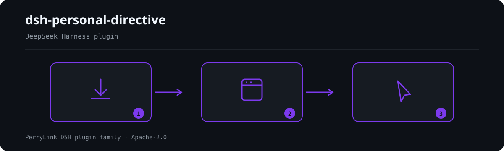

# dsh-personal-directive

> Release stamp: `0.2.9` (2026-10-04).

> ⚠️ Este projeto foi retirado do ecossistema DSH e não participa mais de nenhuma listagem de catálogo (2026-09-13).

- **Canal da loja 1024**: rode `npm i -g dsh1024` uma vez e depois `dsh1024 plugin --profile web add dsh-personal-directive` (conta para o ranking de instalações do [deepseek1024.com](https://deepseek1024.com)).

Edição **de framework** do fork de «Infinite Generation One» para o DeepSeek Harness: mantém a forma de plugin do repositório original (injeção de system prompt + ferramenta + chave de execução no topo), mas **não distribui o conteúdo do prompt original** — substitui-o por uma diretiva de espaço reservado neutra que você pode trocar pelas suas próprias instruções pessoais.

> Este projeto é uma edição pessoal derivada do projeto original, não uma publicação oficial do autor original.



*Visão geral do fluxo: instalar → abrir painel → agir. Os exemplos abaixo usam a superfície real de comandos.*

## Instalação

### A partir do GitHub

Recomenda-se instalar direto do GitHub:

```powershell
dsh plugin --profile web add github:PerryLink/dsh-personal-directive
```

Se o `dsh` não estiver no PATH, use o comando do diretório de instalação do DSH:

```powershell
& "D:/deepseek-harness/node_modules/.bin/dsh.cmd" plugin --profile web add github:PerryLink/dsh-personal-directive
```

Após a instalação, o DSH fará automaticamente:

1. Adicionar o plugin às `dependencies` de `~/.dsh/profiles/web/package.json`.
2. Adicionar `dsh-personal-directive` a `dsh.profile.bundles`.
3. Aplicar o `cordis.patch.yml` que acompanha o plugin.
4. Instalar as dependências do lado servidor e do cliente Web do plugin.

Depois reinicie completamente o `dsh web` e recarregue a página:

```text
http://127.0.0.1:3080
```

### Alternativa de instalação local (git / pack)

Indicada para desenvolvimento, alteração do código ou restauração a partir de uma cópia local. A instalação por git também instala as dependências:

```powershell
dsh plugin --profile <p> add github:PerryLink/dsh-personal-directive
```

Troque `<p>` pelo nome do perfil desejado (por exemplo `web`).

Também é possível empacotar primeiro e instalar pelo tarball local:

```powershell
npm pack
dsh plugin --profile <p> add ./dsh-personal-directive-0.2.0.tgz
```

A instalação empacotada também instala as dependências. Depois de alterar o código é preciso reempacotar, reinstalar e reiniciar o `dsh web` para carregar o novo código do Host ou do cliente Web.

### Trocar de um link local para a versão do GitHub

Se o perfil já tiver um link local com o mesmo nome, remova primeiro a dependência antiga:

```powershell
dsh plugin --profile web remove dsh-personal-directive
dsh plugin --profile web add github:PerryLink/dsh-personal-directive
```

### Atualização

Para atualizar para a versão mais recente depois de instalar pelo GitHub:

```powershell
dsh plugin --profile web update dsh-personal-directive
```

Reinicie completamente o `dsh web` após atualizar.

### Desinstalação

Desinstalar remove apenas o plugin; não apaga outros bundles do usuário:

```powershell
dsh plugin --profile web remove dsh-personal-directive
```

A chave «Diretiva: ativada / Diretiva: desativada» no topo é uma chave de execução e não equivale ao comando de desinstalação acima.

## Compatibilidade

| Aspeto | Estado |
|---|---|
| Harness | DeepSeek Harness `dsh-v0.2.1-alpha.1` (fixado na linha `0.2.1-alpha.1`: `@deepseek-ai/dsh-typert-registry` em devDependencies e `@deepseek-ai/dsh-typert-protocol` em dependencies; com os portões `pnpm run harness:check` e `pnpm test`; os intervalos peer também admitem `>=0.2.1-0 <0.3.0`) |

## Origem do projeto

Projeto original:

- GitHub: https://github.com/Minglink/dsh-infinite-gen-1
- Nome: dsh-infinite-gen-1 / 无限一代 (Infinite Generation One)
- Autor original: Minglink

Esta edição de framework mantém a estrutura do plugin original (injeção do trecho de prompt, ferramenta `personal_directive_profile`, chave no topo da Web) e adiciona um controle visual no topo da Web, além de substituir o conteúdo do prompt por uma diretiva de espaço reservado neutra (veja «Atribuição e licença»).

## O que esta edição adiciona

Em relação ao repositório original, este projeto adiciona principalmente:

- Registra os botões «Diretiva: ativada / Diretiva: desativada» no topo do DeepSeek Harness Web, logo após «concluir indicação».
- Alterna o estado do prompt pela interface remota de execução, sem desinstalar o plugin.
- O plugin permanece instalado e carregado; ao desativar, apenas o trecho de system prompt desta diretiva pessoal passa a devolver conteúdo vazio.
- Ativar ou desativar afeta somente as requisições seguintes do modelo; não altera requisições já enviadas.
- Mantém a forma da ferramenta original `personal_directive_profile` (no original chamava-se `infinite_gen1_profile`).
- As dependências vêm do registro npm (para desenvolvimento local você pode alterar o código e reempacotar/instalar).

A posição da chave é controlada por um slot da UI do DSH:

```text
conversation.session.header.actions
```

Este projeto usa a ordem `1010` para ficar depois do botão existente «concluir indicação».

## Estrutura de diretórios

```text
dsh-personal-directive/
├── index.js                         # Entrada do plugin do lado servidor do Harness e chave de execução
├── lib/
│   └── client.js                    # Chave visual do topo
├── scripts/
│   ├── check-client-contract.mjs    # Verificação do contrato do host (portão de existência de símbolos)
│   ├── check-typert-codec.mjs       # Portão do codec Typert (face única: create())
│   ├── probe-typert-codec-contract.mjs  # Mede o contrato do codec no host instalado
│   └── lib/                         # Helpers compartilhados de análise/origem/reescrita dos portões
├── prompts/
│   └── personal-directive.md        # Diretiva de espaço reservado neutra (substituível pelo seu conteúdo)
├── cordis.patch.yml                 # Declaração de inserção do bundle
├── package.json                     # Metadados de bundle/cliente do Harness
├── pnpm-lock.yaml                   # Arquivo de trava de dependências local
└── README.md
```

## Requisitos de ambiente

- DeepSeek Harness instalado e `dsh web` iniciando normalmente.
- Comando `dsh plugin` disponível.
- `pnpm` no PATH.
- Este tutorial de instalação é voltado ao perfil `web`.

## Uso da chave

Após reiniciar, procure no topo:

```text
完成提示    指令：开启
```

Ao clicar, muda para:

```text
完成提示    指令：关闭
```

Esta chave controla apenas se o prompt de execução entra em vigor:

- Ativada: a próxima requisição do modelo inclui a diretiva pessoal de `prompts/personal-directive.md`.
- Desativada: o plugin continua instalado, mas o trecho de system prompt deste projeto fica vazio.
- Não remove o plugin das `dependencies` do perfil.
- Não remove o plugin de `dsh.profile.bundles`.
- Não apaga o diretório do plugin pessoal.

## Verificar se está em vigor

### Estado no topo

O botão mostrar «Diretiva: ativada» ou «Diretiva: desativada» indica o estado da chave de execução do servidor.

### Ver a requisição real ao modelo

1. Mude para «Diretiva: ativada».
2. Crie uma sessão nova e envie uma mensagem comum.
3. Abra «Trajetória» no topo.
4. Selecione a requisição do Assistant que você acabou de fazer.
5. Abra o detalhe «System Prompt / 系统提示词» à direita.
6. Procure a seguinte característica da diretiva de espaço reservado:

```text
# Personal Directive
```

Com a chave ativada você verá esse conteúdo. Mude para «Diretiva: desativada», envie uma mensagem nova e confira a nova requisição: essas características não devem mais aparecer.

Observação: ao desativar, os outros system prompts do próprio Harness continuam presentes; este projeto remove apenas o seu próprio trecho de prompt.

## Desenvolvimento local e verificações

```powershell
cd <this repository>
pnpm install --ignore-workspace
pnpm run harness:check
pnpm test
```

Além da verificação de sintaxe, o `harness:check` roda a **verificação do contrato do host** (`scripts/check-client-contract.mjs`). Ela pega cada símbolo que `lib/client.js` desestrutura de `@deepseek-ai/dsh-client-ui-primitives` do host e verifica cada um contra a superfície de tipos do host (`lib/types/**/*.d.ts`) **e** suas exportações de execução (`lib/index.js`); também confere se os valores de `variant` passados ao `Button` ainda pertencem à união `ButtonVariant` do host. **Um símbolo removido pelo host é reportado pelo nome com saída diferente de zero**, de modo que essa classe de regressão silenciosa (não montar) não passa mais pelo `node --check` — que só prova que o arquivo é analisado, enquanto `React.createElement(undefined)` não lança até o React renderizá-lo.

A verificação localiza um checkout do host automaticamente (um `deepseek-harness` irmão deste repositório, um diretório ancestral ou uma raiz de unidade conhecida), ou você pode apontá-lo explicitamente:

```powershell
node scripts/check-client-contract.mjs --host D:/deepseek-harness
$env:DSH_HOST_ROOT = "D:/deepseek-harness"; pnpm run check:client-contract
```

Se ela informar que nenhum checkout do host foi encontrado, defina `DSH_HOST_ROOT` com o caminho do seu checkout do DeepSeek Harness.

O `harness:check` também roda a **verificação do codec Typert** (`scripts/check-typert-codec.mjs`). Um codec de invocação Typert é `{ mode: 'strict', typeSymbol, create }`; na linha 0.1.5 era `{ mode, typeSymbol, schema }`, e o host 0.1.7 recusa a forma antiga na montagem — `validateCodec` lança `typert: <id> result strict codec has no create() factory`, a linha do plugin não ativa e nada mais neste repositório consegue ver isso: o literal antigo é um objeto perfeitamente válido, então `node --check` passa e um Context de teste o aceita. A verificação é o espelho local dessa regra do host. Ela constrói os artefatos reais das duas faces — o manifesto `TYPERT` exportado por `index.js` e a contribuição que `lib/client.js` entrega a `ctx.remote.$mount` —, percorre cada descritor e exige que cada codec tenha uma **função** `create()` e nenhum membro `schema`, nomeando o id de invocação infrator. O `test/typert-mount.test.mjs` vai além: registra as duas faces com um `@deepseek-ai/dsh-typert-registry` real sobre um `Context` real do Cordis, depois reconstrói em memória o codec recusado da linha 0.1.5 e confirma que o registro o recusa — assim fica provado que o portão consegue falhar.

```powershell
node scripts/check-typert-codec.mjs
```

O `scripts/probe-typert-codec-contract.mjs` responde à outra metade da pergunta contra o host *instalado*, em vez da leitura que este repositório faz dele: registra um codec `{ mode, typeSymbol, schema }` e um codec `create()` nas duas faces com o registro real, e confirma que o primeiro é recusado e o segundo aceito. Rode-o depois de subir a linha do host para remedir a suposição que o portão codifica.

```powershell
pnpm run probe:typert-codec
```

Conferir a composição do bundle do perfil Web:

```powershell
dsh --profile web --dump-config
```

A saída deve incluir:

```text
id: personal-directive
name: dsh-personal-directive
```

## Segurança e escopo de uso

Esta edição de framework **não inclui o conteúdo do prompt original**: o que é publicado é uma diretiva de espaço reservado neutra (`prompts/personal-directive.md`); o comportamento em execução é o mesmo de qualquer plugin de «injeção de trecho de system prompt» e afeta apenas o texto de instruções que você mesmo fornece.

Este projeto não altera os pesos do modelo nem contorna as políticas de segurança independentes do serviço remoto de modelos, as permissões do sistema operacional ou as permissões reais de ferramentas do Harness.

## Atribuição e licença

Este projeto baseia-se explicitamente no seguinte projeto original:

```text
https://github.com/Minglink/dsh-infinite-gen-1
```

A atribuição ao autor original e ao projeto original deve ser preservada.

O `LICENSE` na raiz deste repositório é uma declaração MIT do mantenedor deste repositório para o código novo e o código de integração deste projeto. Ele não substitui automaticamente os direitos autorais do projeto original, nem implica que o prompt e o código originais do autor tenham sido relicenciados.

No momento da preparação deste projeto não foi encontrado no repositório original nenhum arquivo `LICENSE` explícito nem identificação de licença do GitHub. Por isso, esta edição de framework adota a terceira via de licença indicada no README original: **publicar apenas o framework de código sem o prompt original** — `prompts/personal-directive.md` foi substituído por uma diretiva de espaço reservado neutra, e cada usuário pode fornecer seu próprio conteúdo de instruções (o caminho original está no link do GitHub acima; verifique por conta própria o estado de licença do original).

A declaração MIT deste repositório não deve ser interpretada como autorização do autor original sobre o conteúdo original. Se o autor original adicionar uma licença depois, atualize esta seção e o arquivo de licença do repositório em conjunto.

## Agradecimentos

Agradecemos ao autor do projeto original, Minglink, pela implementação original e pela proposta de prompt do `dsh-infinite-gen-1`. Este repositório apenas acrescenta, sobre essa base, a gestão do diretório pessoal, a chave de execução no topo do Harness Web e o código de integração relacionado.

## PerryLink DSH Plugin Family

Este projeto faz parte da família de plugins do DeepSeek Harness da [PerryLink](https://github.com/PerryLink). O registro fica recolhido abaixo para que cada README mantenha uma primeira tela curta; expanda para ver cada linha e seu status.

<details>
<summary>Expandir todos os plugins</summary>

| Plugin | Status |
|---|---|
| **[dsh-aqua-input-check](https://github.com/PerryLink/dsh-aqua-input-check)** |  |
| **[dsh-archive-check](https://github.com/PerryLink/dsh-archive-check)** |  |
| **[dsh-auto-review](https://github.com/PerryLink/dsh-auto-review)** |  |
| **[dsh-autotier](https://github.com/PerryLink/dsh-autotier)** |  |
| **[dsh-bid-ca-precheck](https://github.com/PerryLink/dsh-bid-ca-precheck)** |  |
| **[dsh-bid-qual-check](https://github.com/PerryLink/dsh-bid-qual-check)** |  |
| **[dsh-cert-mcp](https://github.com/PerryLink/dsh-cert-mcp)** |  |
| **[dsh-checkpoint-rewind](https://github.com/PerryLink/dsh-checkpoint-rewind)** |  |
| **[dsh-click](https://github.com/PerryLink/dsh-click)** |  |
| **[dsh-composer-history](https://github.com/PerryLink/dsh-composer-history)** |  |
| **[dsh-contract-stance](https://github.com/PerryLink/dsh-contract-stance)** |  |
| **[dsh-customs-doc-check](https://github.com/PerryLink/dsh-customs-doc-check)** |  |
| **[dsh-data-quality](https://github.com/PerryLink/dsh-data-quality)** |  |
| **[dsh-demurrage-ledger](https://github.com/PerryLink/dsh-demurrage-ledger)** |  |
| **[dsh-doublecheck](https://github.com/PerryLink/dsh-doublecheck)** |  |
| **[dsh-drill-script-check](https://github.com/PerryLink/dsh-drill-script-check)** |  |
| **[dsh-eia-guide-check](https://github.com/PerryLink/dsh-eia-guide-check)** |  |
| **[dsh-emergency-plan](https://github.com/PerryLink/dsh-emergency-plan)** |  |
| **[dsh-essay-rubric-check](https://github.com/PerryLink/dsh-essay-rubric-check)** |  |
| **[dsh-evidence-check](https://github.com/PerryLink/dsh-evidence-check)** |  |
| **[dsh-export-ctl-check](https://github.com/PerryLink/dsh-export-ctl-check)** |  |
| **[dsh-fast](https://github.com/PerryLink/dsh-fast)** |  |
| **[dsh-fmea-table-check](https://github.com/PerryLink/dsh-fmea-table-check)** |  |
| **[dsh-forecast-penalty](https://github.com/PerryLink/dsh-forecast-penalty)** |  |
| **[dsh-fund-research](https://github.com/PerryLink/dsh-fund-research)** |  |
| **[dsh-github](https://github.com/PerryLink/dsh-github)** |  |
| **[dsh-gongwen-flow-check](https://github.com/PerryLink/dsh-gongwen-flow-check)** |  |
| **[dsh-gongwen-word-check](https://github.com/PerryLink/dsh-gongwen-word-check)** |  |
| **[dsh-guard-plan-qc](https://github.com/PerryLink/dsh-guard-plan-qc)** |  |
| **[dsh-hazchem-check](https://github.com/PerryLink/dsh-hazchem-check)** |  |
| **[dsh-hazplan-check](https://github.com/PerryLink/dsh-hazplan-check)** |  |
| **[dsh-hidden-risk-map](https://github.com/PerryLink/dsh-hidden-risk-map)** |  |
| **[dsh-hs-classify](https://github.com/PerryLink/dsh-hs-classify)** |  |
| **[dsh-icd-rule-check](https://github.com/PerryLink/dsh-icd-rule-check)** |  |
| **[dsh-industry-research](https://github.com/PerryLink/dsh-industry-research)** |  |
| **[dsh-lawcite-adapter](https://github.com/PerryLink/dsh-lawcite-adapter)** |  |
| **[dsh-laya](https://github.com/PerryLink/dsh-laya)** |  |
| **[dsh-lc-doc-check](https://github.com/PerryLink/dsh-lc-doc-check)** |  |
| **[dsh-learning-gap-check](https://github.com/PerryLink/dsh-learning-gap-check)** |  |
| **[dsh-library](https://github.com/PerryLink/dsh-library)** |  |
| **[dsh-local-ai](https://github.com/PerryLink/dsh-local-ai)** |  |
| **[dsh-lsp-actions](https://github.com/PerryLink/dsh-lsp-actions)** |  |
| **[dsh-mask](https://github.com/PerryLink/dsh-mask)** |  |
| **[dsh-mcp-panel](https://github.com/PerryLink/dsh-mcp-panel)** |  |
| **[dsh-medrec-qc](https://github.com/PerryLink/dsh-medrec-qc)** |  |
| **[dsh-memento](https://github.com/PerryLink/dsh-memento)** |  |
| **[dsh-nsfc-form-check](https://github.com/PerryLink/dsh-nsfc-form-check)** |  |
| **[dsh-nurse-record-check](https://github.com/PerryLink/dsh-nurse-record-check)** |  |
| **[dsh-observe](https://github.com/PerryLink/dsh-observe)** |  |
| **[dsh-origin-rvc-check](https://github.com/PerryLink/dsh-origin-rvc-check)** |  |
| **[dsh-ota-review-check](https://github.com/PerryLink/dsh-ota-review-check)** |  |
| **[dsh-output-styles](https://github.com/PerryLink/dsh-output-styles)** |  |
| **[dsh-paper-doc-adapter](https://github.com/PerryLink/dsh-paper-doc-adapter)** |  |
| **[dsh-permission-rules](https://github.com/PerryLink/dsh-permission-rules)** |  |
| **[dsh-permit-report-check](https://github.com/PerryLink/dsh-permit-report-check)** |  |
| **[dsh-pipeline-check](https://github.com/PerryLink/dsh-pipeline-check)** |  |
| **[dsh-pleading-draft](https://github.com/PerryLink/dsh-pleading-draft)** |  |
| **[dsh-plugin-doctor](https://github.com/PerryLink/dsh-plugin-doctor)** |  |
| **[dsh-plugin-guide](https://github.com/PerryLink/dsh-plugin-guide)** |  |
| **[dsh-plugin-kit](https://github.com/PerryLink/dsh-plugin-kit)** |  |
| **[dsh-plugin-upgrade](https://github.com/PerryLink/dsh-plugin-upgrade)** |  |
| **[dsh-policy-brief-draft](https://github.com/PerryLink/dsh-policy-brief-draft)** |  |
| **[dsh-power-loss-split](https://github.com/PerryLink/dsh-power-loss-split)** |  |
| **[dsh-power-ticket-check](https://github.com/PerryLink/dsh-power-ticket-check)** |  |
| **[dsh-ppap-check](https://github.com/PerryLink/dsh-ppap-check)** |  |
| **[dsh-protest-deadline](https://github.com/PerryLink/dsh-protest-deadline)** |  |
| **[dsh-railway-window](https://github.com/PerryLink/dsh-railway-window)** |  |
| **[dsh-repair-order-qc](https://github.com/PerryLink/dsh-repair-order-qc)** |  |
| **[dsh-research-report](https://github.com/PerryLink/dsh-research-report)** |  |
| **[dsh-review-reply-check](https://github.com/PerryLink/dsh-review-reply-check)** |  |
| **[dsh-rulefile-check](https://github.com/PerryLink/dsh-rulefile-check)** |  |
| **[dsh-safety-brief-check](https://github.com/PerryLink/dsh-safety-brief-check)** |  |
| **[dsh-score](https://github.com/PerryLink/dsh-score)** |  |
| **[dsh-session-sync](https://github.com/PerryLink/dsh-session-sync)** |  |
| **[dsh-site-log-check](https://github.com/PerryLink/dsh-site-log-check)** |  |
| **[dsh-skill-pack-security](https://github.com/PerryLink/dsh-skill-pack-security)** |  |
| **[dsh-soe-decision-check](https://github.com/PerryLink/dsh-soe-decision-check)** |  |
| **[dsh-soilwater-check](https://github.com/PerryLink/dsh-soilwater-check)** |  |
| **[dsh-sop-sync-check](https://github.com/PerryLink/dsh-sop-sync-check)** |  |
| **[dsh-spc-gbt-adapter](https://github.com/PerryLink/dsh-spc-gbt-adapter)** |  |
| **[dsh-talk](https://github.com/PerryLink/dsh-talk)** |  |
| **[dsh-tender-extract](https://github.com/PerryLink/dsh-tender-extract)** |  |
| **[dsh-tender-matrix](https://github.com/PerryLink/dsh-tender-matrix)** |  |
| **[dsh-test-drive](https://github.com/PerryLink/dsh-test-drive)** |  |
| **[dsh-ticktick](https://github.com/PerryLink/dsh-ticktick)** |  |
| **[dsh-translate](https://github.com/PerryLink/dsh-translate)** |  |
| **[dsh-warranty-calc](https://github.com/PerryLink/dsh-warranty-calc)** |  |
| **[dsh-budget](https://github.com/PerryLink/dsh-budget)** | 🧊 CONGELADO — ver o README do repositório |
| **[dsh-claude-move](https://github.com/PerryLink/dsh-claude-move)** | 🧊 CONGELADO — ver o README do repositório |
| **[dsh-defend](https://github.com/PerryLink/dsh-defend)** | 🧊 CONGELADO — ver o README do repositório |
| **[dsh-draw](https://github.com/PerryLink/dsh-draw)** | 🧊 CONGELADO — ver o README do repositório |
| **[dsh-reach](https://github.com/PerryLink/dsh-reach)** | 🧊 CONGELADO — ver o README do repositório |
| **[dsh-background-agents](https://github.com/PerryLink/dsh-background-agents)** | 🚫 RETIRADO — ver o README do repositório |
| **[dsh-session-pin](https://github.com/PerryLink/dsh-session-pin)** | 🚫 RETIRADO — ver o README do repositório |
| **[dsh-team-rooms](https://github.com/PerryLink/dsh-team-rooms)** | 🚫 RETIRADO — ver o README do repositório |

</details>